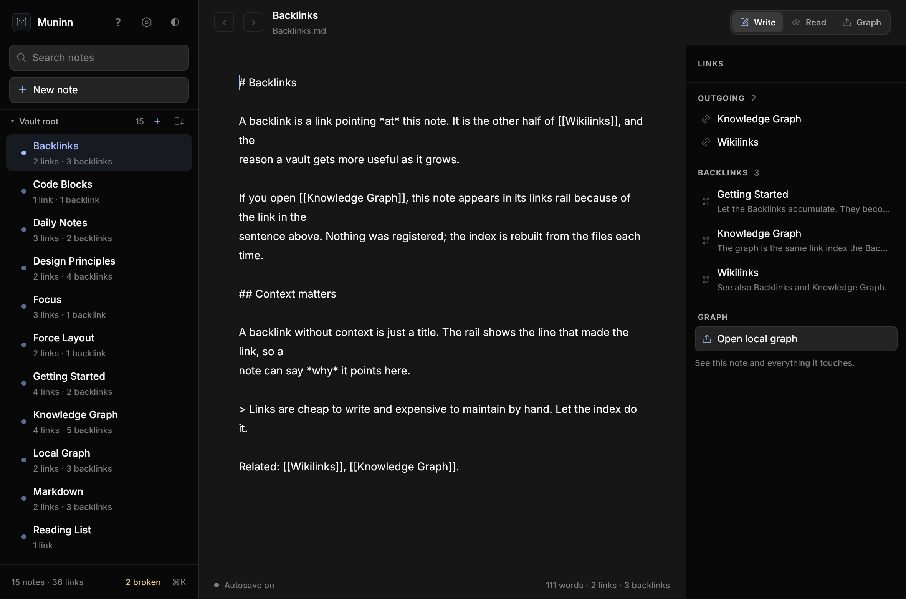
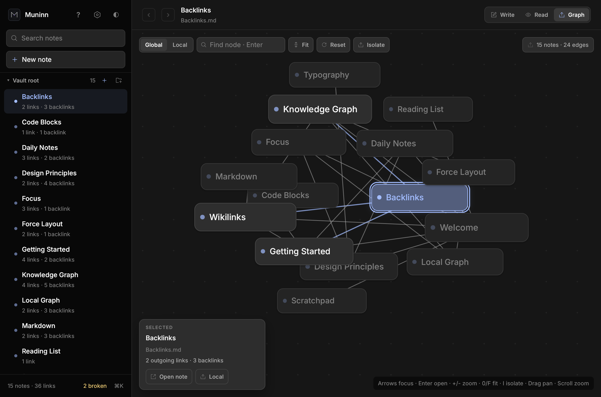
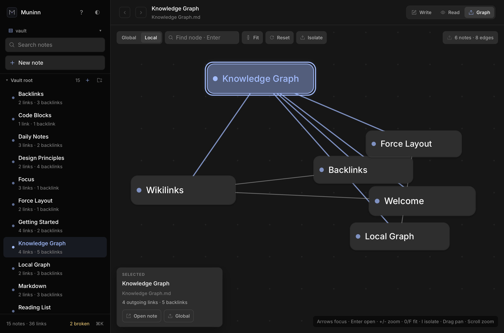

<p align="center">
  
</p>

# Muninn

A local-first Markdown vault with an Obsidian-style wikilink graph, built with
[Rune](https://github.com/anomalyco/rune).

Muninn treats a folder of `.md` files as the whole database. Every note is a file you can read,
move, diff or put in version control. Links are written as `[[Note]]`, `[[Note|alias]]` or
`[[Note#heading]]`; the app indexes them and draws the result as a graph.

| Write | Graph |
| --- | --- |
|  |  |

## Quick start

Muninn needs Rust **1.99.1** (the pinned toolchain in `rust-toolchain.toml`). On Linux, install
the usual windowing headers first:

```sh
sudo apt-get install -y pkg-config libxcb-render0-dev libxcb-shape0-dev \
  libxcb-xfixes0-dev libxkbcommon-dev libwayland-dev libgl1-mesa-dev
```

Run it against the committed sample vault:

```sh
cargo run -p muninn-app -- --vault vault
```

Or point it at your own notes:

```sh
cargo run -p muninn-app -- --vault ~/notes
MUNINN_VAULT=~/notes cargo run -p muninn-app
```

Without `--vault` or `MUNINN_VAULT`, Muninn reopens the last vault recorded in its
settings file (falling back to `~/Muninn`, created when needed).

### Headless checks

Two commands inspect a vault without opening a window (no GPU context is created):

```sh
cargo run -p muninn-app -- --check ~/notes
cargo run -p muninn-app -- --list-links ~/notes
```

`--check` prints the note count, every broken link as `referrer -> target`, duplicate
titles with their note counts, the skipped-file count and a folder-depth warning. It
exits `0` when clean, `1` when there are broken links or duplicate titles, and `2` when
the path is not a readable vault folder. It never creates a missing folder. `--list-links`
prints one sorted `referrer -> target` line per wikilink, with unresolved targets
prefixed `missing:`. `muninn --help` prints this usage without starting Rune.

### Settings and vaults

Preferences live in `$XDG_CONFIG_HOME/muninn/settings.json` (fallback
`~/.config/muninn/`). The file is small JSON and is updated as you change things; a corrupt or
missing file starts from defaults instead of blocking startup. It remembers the theme,
collapsed folders, the last vault and note, Write/Read/Graph mode, Global/Local scope, the
autosave delay (0.55 s by default) and up to five recent vaults.

The default theme follows the shared Omarchy system theme
(`~/.local/state/omarchy/current/theme/colors.toml`), so `omarchy theme set` recolours the
window live; off Omarchy it falls back to the system appearance. The sidebar theme button
cycles Omarchy → System → Dark → Light, and `muninn --theme omarchy|system|dark|light`
overrides that for one session. `MUNINN_OMARCHY_COLORS` can point at a palette file.

Window size and position are deliberately **not** persisted. Rune (rev `b39c24f`) can *set*
an initial and runtime size or position — `AppSpec::size`
(`crates/rune/src/tooling.rs:19`, applied as the inner size at
`crates/rune/src/windows.rs:148`), `Tx::resize_window`
(`crates/rune/src/el/tx.rs:255`) and `AppHandle::set_position`
(`crates/rune/src/app.rs:579`) — but exposes no getter for the current size or position on
`AppHandle`, `WindowHandle` or `Cx`. Its only persistence helper,
`rune_mac::remember_frame` / `saved_size` (`crates/rune-mac/src/lib.rs:15,78`), uses AppKit
and is a no-op on Linux. `settings.json` therefore has no window field instead of one that
could never be read back; the reasoning is recorded in
[ARCHITECTURE.md](ARCHITECTURE.md) (step 10).

The **vault chip** at the top of the sidebar opens an in-window menu — there is no native
menu bar on Linux. **Open vault…** takes a typed path (`~` expands to your home folder) and
**New vault…** creates a missing folder and opens it empty. Recent vaults are listed newest
first, and opening one promotes it to the top. `Cmd/Ctrl+?` (or the sidebar `?` button, or plain
`?` when no text field has focus) opens the full shortcut map; `Esc` closes it.

### Session log and diagnostics

Muninn appends short, timestamped lines to
`$XDG_STATE_HOME/muninn/session.log` (fallback `~/.local/state/muninn/session.log`):
startup build/vault/counts, vault opens with scan time, saved and failed saves, conflict
raises, trash/restore and watcher reloads. Lines carry keys only (vault-relative names,
counts, results) and **never note bodies**, so the file is safe to attach to a bug report.
`--trace` adds every autosave tick. The Help overlay shows the last five lines plus the
version, Rune revision and vault counts, with a **Copy diagnostics** button.

`MUNINN_REDUCED_MOTION=1` (also `true`, `yes` or `on`) freezes the force layout: nodes
keep their deterministic seed positions, no auto-settle wakes the window, and pan, zoom
and fit still work. Prefer this over replacing the theme when motion is a problem.

## What it does

- **Write / Read / Graph** modes for the same note.
- Autosave after a short idle, with a `Saved` indicator in the status bar.
- Searchable note list grouped by folder with collapsing sections, a links rail with outgoing links
  and backlinks (including the line that made each link), and a one-click local graph.
- **Global** and **Local** graph views. Local keeps the open note and its immediate neighbours.
- Dragging a graph node pins it while you drag; the force layout settles around it. Drag the
  background to pan, scroll to zoom at the pointer, Shift+scroll to pan, pinch or Ctrl/Cmd+scroll
  to zoom.
- The graph is keyboard-complete: arrows move a focus ring between visible notes, `Enter` opens
  the focused note, `+`/`-` zoom, `0`/`F` fit, and `Esc` leaves. The **Find node** field selects
  and centres a title or path; **Isolate** dims everything outside the selection's neighbourhood.
  Hub notes draw larger, and at far zoom labels thin to dots in Local as well as Global.
- Unresolved wikilinks are drawn faintly in Read mode. Clicking one creates the note and opens
  it in Write mode. Path-qualified links (`[[folder/note]]`) resolve to that folder; a bare
  title shared by several notes resolves deterministically and displays with its folder.
- Attachments are files, not notes: only `.md` files are indexed. An embed such as
  `![[pic.png]]` renders in Read mode as a filename-and-size placeholder, not a faint missing
  note link, and the reader's attachment strip lists each file with **Open**. Rune's Markdown
  view has no image pipeline in this revision and `Tx::open_url` refuses `file:` URLs, so Open
  hands the canonical path to the platform handler instead (`xdg-open` on Linux, `open` on
  macOS, `start` on Windows). Right-click a note for **Open externally** and **Reveal in file
  manager**.
- Drop files on the window to import them into the current folder: `.md` becomes a note and
  opens, while png/jpg/jpeg/gif/webp/pdf files are copied as attachments that stay out of the
  sidebar (the status bar reports the count). Imports are atomic copies and never overwrite:
  an existing filename is refused with its name. File drops work on macOS, Windows and X11;
  Wayland reports no file drags to winit 0.30, so dropping from a file manager there does
  nothing — use the sidebar actions instead.
- Word count uses whitespace splitting, so a CJK run without spaces counts as one word
  (documented, not locale-aware segmentation). Unicode titles (CJK, accents, RTL) search and
  resolve by the same case-folded title/path rules as ASCII.
- **New note** asks for a name first (empty or cancelled creates nothing) and targets the
  current or chosen folder. Right-click a note or folder for rename, delete, move and
  new-note/new-folder actions; rename/delete also appear with `F2` and `Delete`. Folder
  deletes are empty-only. Deleted notes move to the vault's hidden `.muninn-trash` folder so
  Undo can restore them; the trash keeps at most 500 files or 100 MB, pruning the oldest
  timestamp folder first. The Help overlay shows the current size with an **Empty trash**
  button that permanently clears it without touching live notes.

In **Local** mode the graph keeps the open note and its immediate neighbours:



## Keys

| Shortcut | Action |
| --- | --- |
| `⌘K` / `Ctrl+K` | Focus search |
| `↑` / `↓` (search) | Move the highlighted search result |
| `Enter` (search) | Open the highlighted result (first when none is highlighted) |
| `Esc`, then `Tab` | Release the editor and start keyboard traversal at the links rail |
| `↑` / `↓` (rail) | Move through outgoing links and backlinks |
| `Enter` / `Space` (rail, note list) | Open the focused note or link |
| `Enter` / `Space` (broken links) | Open the focused dashboard target or referrer |
| `Tab` / `Shift+Tab` | Move between the rail, search, note list, broken-links chip and editor |
| `⌘F` / `Ctrl+F` | Find in the open note |
| `Enter` / `Shift+Enter` (find) | Next / previous match |
| `[[` (editor) | Open wikilink completion for the note being typed |
| `Enter` (editor) | Continue a list item, end an empty one, or close an open `[[` when completion is not showing |
| `Tab` (editor) | Indent four spaces instead of leaving the note |
| `↑` / `↓` (completion) | Move the highlighted suggested note |
| `Enter` / `Tab` (completion) | Insert `[[stem]]` for the highlighted note |
| `Esc` (completion) | Dismiss the list, then find, then prompts and menus |
| `⌘P` / `Ctrl+P` | Insert a wikilink at the caret (link picker, not feed search) |
| `⌘[` / `Ctrl+[` | Back in note history |
| `⌘]` / `Ctrl+]` | Forward in note history |
| `⌘N` / `Ctrl+N` | New note |
| `⌘S` / `Ctrl+S` | Save now (autosave is already on) |
| `⌘E` / `Ctrl+E` | Toggle Write / Read |
| `⌘G` / `Ctrl+G` | Toggle Graph |
| `⌘L` / `Ctrl+L` | Toggle Global / Local graph |
| `⌘1` / `⌘2` / `⌘3` | Write / Read / Graph |
| `↑` / `↓` / `←` / `→` (graph) | Move the focus ring to the nearest node (sorted order wraps when no node lies that way) |
| `Enter` (graph) | Open the focused note |
| `+` / `-` (graph) | Zoom in / out at the canvas centre |
| `0` / `F` (graph) | Fit the visible nodes |
| `I` (graph) | Toggle Isolate (dim non-neighbours) |
| `Enter` (Find node) | Select and centre the best title/path match |
| `Esc` | Leave the graph |
| `F2` | Rename selected note |
| `Del` | Delete selected note (with confirmation) |
| `⌘?` / `Ctrl+?` | Open the keyboard-shortcuts Help overlay |
| `?` (when not typing) | Open Help; `Esc` closes it |
| Vault chip | Open / recent / new vault, typed path support |

Typing `[[` shows notes whose title or path matches what follows; the list inserts the
full vault-relative stem, so a link keeps working when two notes share a title.
`[[Note#Heading]]` opens the note at that heading (caret in Write, scroll in Read).
The sidebar's broken-links chip counts unresolved targets; open it to create a missing
note or jump to a referrer.

Tab order is rail → search → note list → broken-links chip → editor. `Tab` indents
inside the editor (EDT-05), so press `Esc` once to release it: the next `Tab` lands on
the links rail. `↑`/`↓` then move through outgoing links and backlinks and `Enter`
opens one, all without a pointer. The sidebar note rows and broken-links dashboard rows
use the same list pattern.

## Crates

The workspace is split by responsibility so each layer can be tested and reused on its own:

```text
muninn-app        binary: CLI, scenes, Rune entry point
    │
muninn-ui         application state, shortcuts, views, graph canvas
    │
muninn-graph      deterministic force layout and camera math (no Rune)
    │
muninn-core       vault scanning, wikilink parsing, indexes, preview
```

| Crate | Responsibility |
| --- | --- |
| `crates/muninn-core` | Files, notes, wikilinks, backlinks, search, Markdown preview rewrite. No UI dependencies. |
| `crates/muninn-graph` | Pure layout and camera math. Takes a `Vault`, produces positions. |
| `crates/muninn-ui` | `State`, Rune views, key handling, autosave. Headlessly testable. |
| `crates/muninn-app` | The `muninn` binary: argument parsing and `rune::run`. |
| `xtask` | `cargo run -p xtask -- check`, layering checks, bundling, snapshots. |

Dependency direction is enforced by `cargo run -p xtask -- layers`. See
[ARCHITECTURE.md](ARCHITECTURE.md) for the data flow and invariants.

## Development

```sh
cargo run -p xtask -- check     # fmt, clippy, tests, layering
cargo run -p xtask -- test
cargo run -p xtask -- fmt
cargo run -p xtask -- layers
cargo run -p xtask -- run --vault vault
```

Rune is pinned to a git revision because it is not published to crates.io. To develop Muninn
against a local Rune checkout:

```sh
./scripts/use-local-rune.sh
# or
RUNE_DIR=/path/to/rune ./scripts/use-local-rune.sh
```

The script writes a gitignored `.cargo/config.toml` patch. Remove that file to return to the
pinned revision.

### Headless snapshots

The Rune runtime can render scenes without a window:

```sh
target/debug/muninn --vault vault --snap notes.png --scene notes
target/debug/muninn --vault vault --snap graph.png --scene graph
```

Scenes are `notes`, `preview`, `graph`, `local`, `light` and `empty`. `cargo run -p xtask --
snapshots` writes all of them to `target/snapshots/`.

## Releasing

Releases are cut from tags:

```sh
git tag -a v0.1.0 -m "v0.1.0"
git push origin v0.1.0
```

The release workflow builds Linux, macOS and Windows archives, writes checksums and publishes a
GitHub release. Tags containing a hyphen (`v0.2.0-rc.1`) are marked as prereleases.

## License

MIT. See [LICENSE](LICENSE).
