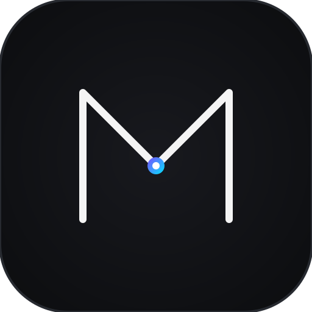
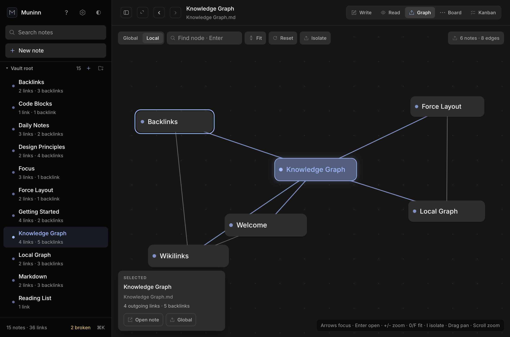
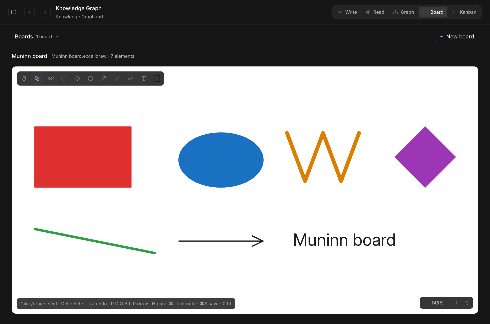
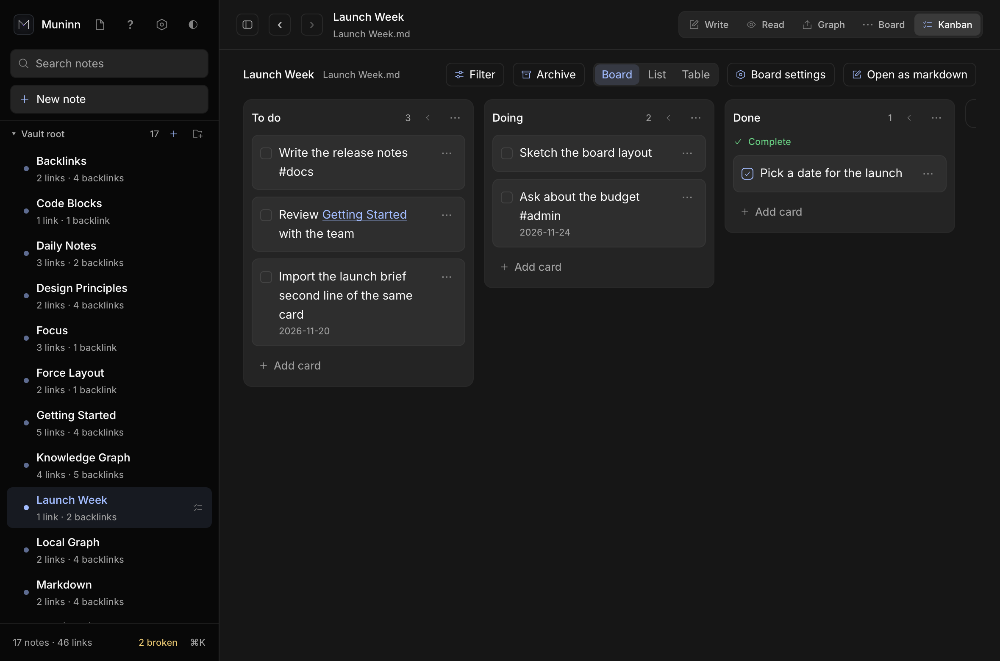

<p align="center">
  
</p>

<h1 align="center">Muninn</h1>

<p align="center">
  A local-first Markdown notebook with a graph, a whiteboard and a Kanban board —<br />
  no database, no lock-in, just a folder of <code>.md</code> files.
</p>

<p align="center">
  <a href="#what-you-get">What you get</a> ·
  <a href="#a-look-inside">Screenshots</a> ·
  <a href="#install">Install</a> ·
  <a href="#sync">Sync</a> ·
  <a href="#keys">Keys</a> ·
  <a href="#lock-a-note">Lock a note</a> ·
  <a href="#license">License</a>
</p>

Muninn opens a folder you choose and treats the Markdown inside it as the whole database. Every
note is a file you can read in any editor, diff, back up or keep in version control. Links are
written as `[[Note]]`, `[[Note|alias]]` or `[[Note#heading]]`; Muninn indexes them and draws the
connections as a graph.

## Sponsors

Muninn's development is backed by its sponsors, and every one of them has this
project's lasting gratitude — thank you for finding the work worth backing.

<p align="center">
  <a href="https://github.com/Synteq-HPC">
    
  </a>
</p>

**[Synteq](https://github.com/Synteq-HPC)** ([synteq.com](https://synteq.com)) — deploy globally,
scale easily, and build on the platform that offers incredibly fast compute solutions.

If Muninn is useful to you, consider
[sponsoring its development](https://github.com/sponsors/raythurman2386).

## What you get

- **Your notes stay yours.** The vault is a folder of `.md` files — read it, diff it, back it up,
  or move it with anything you already use.
- **Lock a note.** Give a note its own password and its `.md` file becomes a UTF-8 ciphertext
  envelope; the body, tags and content links stay out of the editor, search, graph text and sync
  until you unlock it. Kanban stays closed for locked notes in v1. There is no password reset.
- **Links become a map.** `[[Note]]`, `[[Note|alias]]` and `[[Note#heading]]` resolve into
  backlinks and a graph; click a missing link to create the note.
- **Write or Read.** A focused editor with `[[` completion, and a reader that resolves links,
  backed by a rail of outgoing links and backlinks.
- **Draw on a whiteboard.** Board mode edits `.excalidraw` files in place: rectangles, diamonds,
  ellipses, arrows, lines, freehand and text, with selection, nudging and undo — and a
  double-click writes or edits a shape's text label.
- **Kanban inside the note.** Lanes, cards, dates, tags, archive, filters and Board / List /
  Table views, all stored as Markdown.
- **Paste as Markdown.** Rich text from a browser or document arrives with its headings, lists,
  links and emphasis; paste a URL over a selection to make `[selection](url)`.
- **Import documents.** Word, PowerPoint, Excel, OpenDocument, RTF, EPUB, CSV and text PDFs
  become a new Markdown note in the current folder — via the sidebar's import icon, `⌘I` /
  `Ctrl+I`, the command palette, or a drop on the window. The converted images and the original
  document are kept beside the note, and the conversion runs locally with no OCR or network.
- **Saves itself.** Autosave after a short idle (0.55 s by default), atomic writes, and a trash
  you can undo.
- **Sync when you choose.** GitHub, Google Drive or Tailscale, with a manual Sync Now and sync
  credentials kept in the OS key store.
- **Matches your desktop.** Follows the Omarchy system theme by default, with System, Dark and
  Light alternatives, a working Reduce motion setting, and Graph effects presets (Classic,
  Electric, Off) with a Subtle / Balanced / Intense strength, treating the selection's border
  and its edges as one style — and burn a deleted note out of the graph or the sidebar.
- **Focus.** One chord hides everything but the note, dims the other paragraphs and keeps the
  caret's line centred.
- **Tells you about new releases.** A once-a-day check (on by default, off in
  **Settings › Appearance › Updates**) names a newer stable version. Tarball
  and AppImage installs can then update in place after the explicit **Update**
  action, with the download's SHA-256 checked (and its signature when a
  verifier is installed); `.deb` and AUR installs stay with their package
  manager. The check sends no notes or vault data and never downloads
  anything by itself; see [the privacy policy](PRIVACY.md).
- **Small comforts.** An opt-in tray icon, start at login and a global shortcut that summons the
  window.

## A look inside

| Write | Graph | Local graph |
| --- | --- | --- |
|  |  |  |
| Write and Read share one note, with the sidebar and links rail always in reach. | The whole vault as a graph, pannable and zoomable, with a Find node field. | Local scope keeps the open note and its immediate neighbours. |

| Board | Kanban |
| --- | --- |
|  |  |
| Draw on an `.excalidraw` board in place: shapes, arrows, freehand, text, selection and undo. | Plan in a Markdown Kanban: drag cards between lanes, add dates and tags, switch Board / List / Table. |

## Install

### Prebuilt releases (Linux and macOS)

Download the installer from the latest release and run it with `sh`. It picks the tarball for
your platform, checks its SHA-256 against the release `checksums.txt`, and verifies the Sigstore
signature when `cosign` (or a GitHub attestation via `gh`) is available:

```sh
curl -fsSLO https://github.com/raythurman2386/muninn/releases/latest/download/install.sh && sh install.sh
```

It installs into `$HOME/.local` by default. Pin a release and a directory with `--version` and
`--prefix`, and remove exactly what was installed with `--uninstall`:

```sh
sh install.sh --version v0.9.0 --prefix /tmp/muninn
/tmp/muninn/bin/muninn --version
sh install.sh --prefix /tmp/muninn --uninstall
```

Maintainers repeat that sequence against each real tag as the release smoke test; the fixture
test in `scripts/tests/install-sh.sh` covers the same flow offline with local assets.

`--require-signature` fails unless a verifier is installed and succeeds; `--no-verify` is an
explicit opt-out of both checksum and signature checks; `--help` lists every flag. The installer
never runs `sudo`: if the prefix is not writable it prints the exact command for you to run
yourself. Uninstall reads an install receipt and removes only those files — it never touches
`~/.config/muninn`, sync state or a vault.

| Platform | Asset | How to install |
| --- | --- | --- |
| Linux x86_64 | `muninn_<TAG>_linux_x86_64.tar.gz` | `sh install.sh` (also installs the desktop file and icons under `$PREFIX/share`), or unpack by hand. |
| Linux aarch64 | `muninn_<TAG>_linux_aarch64.tar.gz` | Same, on ARM64 Linux. |
| Linux x86_64 / aarch64 (no install) | `muninn_v<VERSION>_linux_x86_64.AppImage` / `muninn_v<VERSION>_linux_aarch64.AppImage` | Download, `chmod +x`, run — see below. |
| Linux x86_64 / aarch64 (Debian, Ubuntu) | `muninn_<VERSION>-1_amd64.deb` / `muninn_<VERSION>-1_arm64.deb` | `sudo apt install ./muninn_<VERSION>-1_amd64.deb` (or the arm64 build). |
| macOS aarch64 (Apple Silicon) | `muninn_<TAG>_macos_aarch64.tar.gz` | `sh install.sh` installs the binary only. |
| Windows x86_64 | `muninn_<TAG>_windows_x86_64.zip` | Unzip the archive; **this script does not support Windows**. |

#### Try it without installing (Linux)

The `.AppImage` is a single file that mounts its own read-only image and runs from anywhere. It
installs nothing: there is no install receipt, no `$PREFIX` and no uninstall step — delete the file
to remove it. Download the `.AppImage` for your architecture from the latest release, make it
executable and run it. Replace `<VERSION>` with the release version **without** the leading `v`
(for example `0.9.1`, giving `muninn_v0.9.1_linux_x86_64.AppImage`):

```sh
curl -fsSLO https://github.com/raythurman2386/muninn/releases/latest/download/muninn_v<VERSION>_linux_x86_64.AppImage
chmod +x muninn_v<VERSION>_linux_x86_64.AppImage
./muninn_v<VERSION>_linux_x86_64.AppImage
```

Use the `muninn_v<VERSION>_linux_aarch64.AppImage` asset on ARM64 Linux. If FUSE is unavailable,
run it with the built-in extractor instead:

```sh
./muninn_v<VERSION>_linux_x86_64.AppImage --appimage-extract-and-run
```

The AppImage carries the same SHA-256 entry in `checksums.txt` and the same Sigstore / GitHub
attestation verification as the other release assets. Its glibc floor follows the release build:
**both x86_64 and aarch64 need glibc 2.39**, so Ubuntu 24.04 LTS or newer (or any distribution
with glibc 2.39+) can run it; older distributions are not supported. It has no built-in
auto-update: download the next release to upgrade.

Release binaries are unsigned by an Apple Developer ID or a Windows code-signing certificate, so
Gatekeeper and SmartScreen may warn on first run. On macOS, open the binary from **System
Settings → Privacy & Security → Open Anyway** (or right-click → **Open**); on Windows, use **More
info → Run anyway** if SmartScreen blocks the zip. For a manual download, check the SHA-256 in
`checksums.txt` and the Sigstore bundle in `checksums.txt.sigstore.json` with `cosign verify-blob`.

**Windows console behaviour.** Double-clicking `muninn.exe` from Explorer opens the app with no
console window. From a terminal, `muninn --version`, `muninn --help`,
`muninn --check <vault>` and `muninn --list-links <vault>` still print output and
return the documented exit codes (0 clean, 1 broken links/duplicates, 2 unreadable vault).
CMD and PowerShell do not wait for GUI-subsystem programs, so a script that needs the exit code
should launch the binary with `Start-Process -Wait -PassThru` (PowerShell) rather than `& muninn ...`.

### Build from source

Rust **1.99.1** is required; it is pinned in `rust-toolchain.toml`. On Linux, install the
windowing headers first:

```sh
sudo apt-get install -y pkg-config libxcb-render0-dev libxcb-shape0-dev \
  libxcb-xfixes0-dev libxkbcommon-dev libwayland-dev libgl1-mesa-dev
```

Then run against the sample vault in this repository:

```sh
cargo run -p muninn-app -- --vault vault
```

### Sample vault

`vault/` is a tutorial, not a hidden database. It includes a Welcome note and Getting
Started, Markdown and wikilink examples, a graph tutorial, a sample Kanban (**Launch Week**) and
a sample Excalidraw board (**Muninn board.excalidraw**). Copy the folder to a scratch location if
you want to edit the examples without dirtying the repository; deleting the copy is the full
reset.

Or point it at your own notes:

```sh
cargo run -p muninn-app -- --vault ~/notes
MUNINN_VAULT=~/notes cargo run -p muninn-app
```

Without either, Muninn reopens the last vault you used, falling back to `~/Muninn` (created
when needed). `⌘,` / `Ctrl+,` opens Settings, where you can switch vaults, pick a theme and UI
language, adjust the autosave delay and default template, choose a graph effect preset or
reduced motion, or set up sync.

### Language

Settings › **Appearance** › **Language** picks the interface language. **System** (the default)
follows your operating system's locale, falling back to English when Muninn has no pack for it.
The picker lists every shipped language under its own name: **English**, **Español**,
**Français**, **Deutsch** and **Português (Brasil)**. An explicit pick is saved in
`settings.json` and restored on the next launch, and a switch re-renders the window and tray
immediately without a restart. Spanish, French and German use Monday-first calendars, Brazilian
Portuguese uses Sunday-first, and each has its own month and weekday names on screen; dates
Muninn writes into a vault stay English and ASCII, so the files do not change with the
interface language. Only what Muninn draws follows it.

### Inspect a vault

Two headless commands read a vault without opening a window:

```sh
cargo run -p muninn-app -- --check ~/notes
cargo run -p muninn-app -- --list-links ~/notes
```

`--check` reports the note count, broken links (`referrer -> target`), duplicate titles, skipped
files and a folder-depth warning. It exits `0` when clean, `1` for broken links or duplicate
titles, and `2` when the folder cannot be read; it never creates a missing folder. `--list-links`
prints one sorted `referrer -> target` line per wikilink, with unresolved targets prefixed
`missing:`.

## Sync

Settings › **Sync** binds the open vault to one provider, and **Sync Now** is a manual action:
press it when you want the vault on another device.

- **GitHub** publishes the vault as ordinary Git files on a branch you choose, building on the
  previous commit and refusing force updates. Use a dedicated repository and branch.
- **Google Drive** keeps an app-managed commit history in Muninn's hidden app-data folder, not as
  a set of editable Markdown files.
- **Tailscale** has one device host a commit store that the others reach by MagicDNS name through
  `tailscale serve`.

Tokens live in the OS credential store, never in `settings.json`. Setting up the OAuth client
and the credential store is described in [docs/sync-setup.md](docs/sync-setup.md).

## Keys

| Shortcut | Action |
| --- | --- |
| `⌘K` / `Ctrl+K` | Focus search |
| `⌘⇧P` / `Ctrl+Shift+P` | Command palette — notes and actions in one input |
| `⌘P` / `Ctrl+P` | Insert a wikilink at the caret |
| `[[` | Wikilink completion while typing |
| `⌘S` / `Ctrl+S` | Save now (autosave is already on) |
| `⌘N` / `Ctrl+N` | New note |
| `⌘I` / `Ctrl+I` | Import a document as a note |
| `⌘E` / `Ctrl+E` | Toggle Write / Read |
| `⌘⇧F` / `Ctrl+Shift+F` | Focus mode: hide the chrome, dim inactive paragraphs, centre the caret |
| `⌘1`…`⌘5` / `Ctrl+1`…`Ctrl+5` | Write / Read / Graph / Board / Kanban |
| `⌘G` / `Ctrl+G` | Toggle the graph |
| `⌘L` / `Ctrl+L` | Graph: Global / Local; Board: link the selection to a note |
| `⌘Enter` / `Ctrl+Enter` | Board: open the selection's linked note |
| `⌘click` / `Ctrl+click` | Board: open the clicked element's linked note |
| `⌘F` / `Ctrl+F` | Find in the note, or in a Kanban board |
| `⌘[` / `⌘]` | Back / forward in note history |
| `F2` / `Del` | Rename / delete the selected note |
| `0` / `F` | Fit the graph or board |
| `+` / `-` | Zoom in / out |
| `I` | Graph: isolate the selection's neighbourhood |
| `R` `D` `O` `A` `L` `P` `T` | Board tools: rectangle, diamond, ellipse, arrow, line, freehand, text |
| `V` / `H` | Board: no tool (select) / hand tool (pan) |
| `⌘,` / `Ctrl+,` | Settings |
| `⌘?` / `Ctrl+?` | The full shortcut map |

The full map — graph navigation, card and lane actions, every board gesture — is in the in-app
Help: `⌘?` or `Ctrl+?`, or plain `?` when no text field has focus. `Esc` closes it.

## Lock a note

Right-click a note and choose **Lock note…**, or run **Lock note** from the command palette. The
prompt asks for the password twice and states the rule plainly: there is no password reset,
recovery key or Muninn account, so a lost password loses the note. Earlier backups and sync
history may still contain the old plaintext.

A locked note keeps its filename and title, but its body, frontmatter, tags and content-derived
links become a versioned `MUNINN-NOTE-LOCK v2` envelope: Argon2id derives the key and AES-256-GCM
authenticates the ciphertext. The note appears in the sidebar with a lock glyph and a lock page;
**Unlock note…** asks for the password and keeps only the derived key for 15 idle minutes. Search,
tags, links and graph text ignore the body until then; Kanban stays closed for locked notes in
v1. Crash recovery is off for a locked note (autosave still writes the envelope).

Renaming or moving a locked note re-encrypts it while it is unlocked; a folder holding a locked
note refuses a folder rename. In v1, Kanban is closed for locked notes, a link inside an unlocked
locked note is not rewritten when another note is renamed, and a sync conflict copy keeps the
original name binding until it is renamed back. The
[design and threat model](docs/per-note-encryption.md) document the full format and the limits.

## Docs

- [Compatibility contract](docs/compatibility.md) — what is stable at 1.0, the deprecation policy
  and the platform floor.
- [Sync setup](docs/sync-setup.md) — the OAuth clients, credential store and Tailscale host.
- [Sync safety](docs/sync-safety.md) — what sync will and will not do with a note.
- [Kanban format](docs/kanban-format.md) — the frontmatter, lanes, cards, dates and settings
  footer.
- [Accessibility checklist](docs/a11y-checklist.md) — a screen-reader pass and what is covered.
- [Internationalisation](docs/i18n.md) — the catalog seam and the locale packs.

## For developers

Muninn is built on Rune, a Rust UI runtime. The workspace splits into `muninn-core` (vault
scanning, links, search), `muninn-graph` (layout and camera math), `muninn-sync`, `muninn-ui`
(state and views) and the `muninn` binary. [ARCHITECTURE.md](ARCHITECTURE.md) explains the data
flow and invariants; [CONTRIBUTING.md](CONTRIBUTING.md) covers setup, `cargo run -p xtask -- check`
and where changes belong.

## License

MIT. See [LICENSE](LICENSE).

## Privacy

Muninn keeps your vault on disk and your settings local. What optional sync can access, and where
credentials are stored, is described in [PRIVACY.md](PRIVACY.md).
