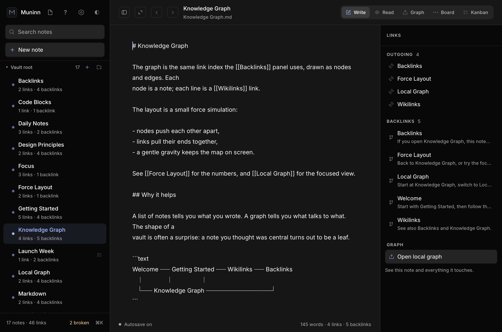
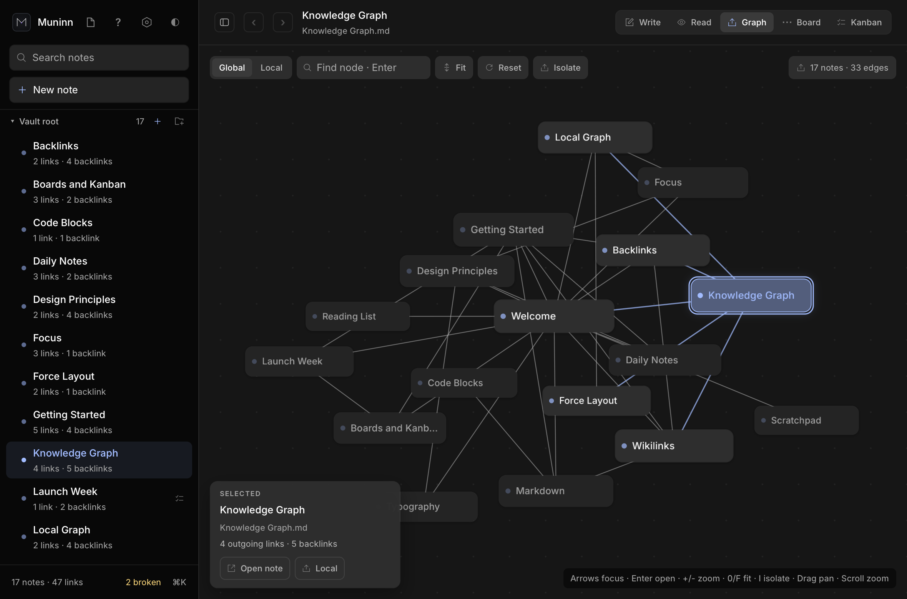

<p align="center">
  
</p>

<h1 align="center">Muninn</h1>

<p align="center">
  A local-first Markdown notebook with a graph, a whiteboard and a Kanban board —<br />
  no database, no lock-in, just a folder of <code>.md</code> files.
</p>

<p align="center">
  <a href="#what-you-get">What you get</a> ·
  <a href="#a-look-inside">Screenshots</a> ·
  <a href="#install">Install</a> ·
  <a href="#sync">Sync</a> ·
  <a href="#keys">Keys</a> ·
  <a href="#license">License</a>
</p>

Muninn opens a folder you choose and treats the Markdown inside it as the whole database. Every
note is a file you can read in any editor, diff, back up or keep in version control. Links are
written as `[[Note]]`, `[[Note|alias]]` or `[[Note#heading]]`; Muninn indexes them and draws the
connections as a graph.

## What you get

- **Your notes stay yours.** The vault is a folder of `.md` files — read it, diff it, back it up,
  or move it with anything you already use.
- **Links become a map.** `[[Note]]`, `[[Note|alias]]` and `[[Note#heading]]` resolve into
  backlinks and a graph; click a missing link to create the note.
- **Write or Read.** A focused editor with `[[` completion, and a reader that resolves links,
  backed by a rail of outgoing links and backlinks.
- **Draw on a whiteboard.** Board mode edits `.excalidraw` files in place: rectangles, diamonds,
  ellipses, arrows, lines, freehand and text, with selection, nudging and undo.
- **Kanban inside the note.** Lanes, cards, dates, tags, archive, filters and Board / List /
  Table views, all stored as Markdown.
- **Paste as Markdown.** Rich text from a browser or document arrives with its headings, lists,
  links and emphasis; paste a URL over a selection to make `[selection](url)`.
- **Saves itself.** Autosave after a short idle (0.55 s by default), atomic writes, and a trash
  you can undo.
- **Sync when you choose.** GitHub, Google Drive or Tailscale, with a manual Sync Now and sync
  credentials kept in the OS key store.
- **Matches your desktop.** Follows the Omarchy system theme by default, with System, Dark and
  Light alternatives, a working Reduce motion setting, and Graph effects presets (Classic,
  Electric, Off) with a Subtle / Balanced / Intense strength, treating the selection's border
  and its edges as one style — and burn a deleted note out of the graph or the sidebar.
- **Focus.** One chord hides everything but the note, dims the other paragraphs and keeps the
  caret's line centred.
- **Small comforts.** An opt-in tray icon, start at login and a global shortcut that summons the
  window.

## A look inside

| Write | Graph | Local graph |
| --- | --- | --- |
|  |  |  |
| Write and Read share one note, with the sidebar and links rail always in reach. | The whole vault as a graph, pannable and zoomable, with a Find node field. | Local scope keeps the open note and its immediate neighbours. |

## Install

Rust **1.99.1** is required; it is pinned in `rust-toolchain.toml`. On Linux, install the
windowing headers first:

```sh
sudo apt-get install -y pkg-config libxcb-render0-dev libxcb-shape0-dev \
  libxcb-xfixes0-dev libxkbcommon-dev libwayland-dev libgl1-mesa-dev
```

Then run against the sample vault in this repository:

```sh
cargo run -p muninn-app -- --vault vault
```

Or point it at your own notes:

```sh
cargo run -p muninn-app -- --vault ~/notes
MUNINN_VAULT=~/notes cargo run -p muninn-app
```

Without either, Muninn reopens the last vault you used, falling back to `~/Muninn` (created
when needed). `⌘,` / `Ctrl+,` opens Settings, where you can switch vaults, pick a theme, adjust
the autosave delay and default template, choose a graph effect preset or reduced motion, or set
up sync.

### Inspect a vault

Two headless commands read a vault without opening a window:

```sh
cargo run -p muninn-app -- --check ~/notes
cargo run -p muninn-app -- --list-links ~/notes
```

`--check` reports the note count, broken links (`referrer -> target`), duplicate titles, skipped
files and a folder-depth warning. It exits `0` when clean, `1` for broken links or duplicate
titles, and `2` when the folder cannot be read; it never creates a missing folder. `--list-links`
prints one sorted `referrer -> target` line per wikilink, with unresolved targets prefixed
`missing:`.

## Sync

Settings › **Sync** binds the open vault to one provider, and **Sync Now** is a manual action:
press it when you want the vault on another device.

- **GitHub** publishes the vault as ordinary Git files on a branch you choose, building on the
  previous commit and refusing force updates. Use a dedicated repository and branch.
- **Google Drive** keeps an app-managed commit history in Muninn's hidden app-data folder, not as
  a set of editable Markdown files.
- **Tailscale** has one device host a commit store that the others reach by MagicDNS name through
  `tailscale serve`.

Tokens live in the OS credential store, never in `settings.json`. Setting up the OAuth client
and the credential store is described in [docs/sync-setup.md](docs/sync-setup.md).

## Keys

| Shortcut | Action |
| --- | --- |
| `⌘K` / `Ctrl+K` | Focus search |
| `⌘⇧P` / `Ctrl+Shift+P` | Command palette — notes and actions in one input |
| `⌘P` / `Ctrl+P` | Insert a wikilink at the caret |
| `[[` | Wikilink completion while typing |
| `⌘S` / `Ctrl+S` | Save now (autosave is already on) |
| `⌘N` / `Ctrl+N` | New note |
| `⌘E` / `Ctrl+E` | Toggle Write / Read |
| `⌘⇧F` / `Ctrl+Shift+F` | Focus mode: hide the chrome, dim inactive paragraphs, centre the caret |
| `⌘1`…`⌘5` / `Ctrl+1`…`Ctrl+5` | Write / Read / Graph / Board / Kanban |
| `⌘G` / `Ctrl+G` | Toggle the graph |
| `⌘L` / `Ctrl+L` | Global / Local graph |
| `⌘F` / `Ctrl+F` | Find in the note, or in a Kanban board |
| `⌘[` / `⌘]` | Back / forward in note history |
| `F2` / `Del` | Rename / delete the selected note |
| `0` / `F` | Fit the graph or board |
| `+` / `-` | Zoom in / out |
| `I` | Graph: isolate the selection's neighbourhood |
| `R` `D` `O` `A` `L` `P` `T` | Board tools: rectangle, diamond, ellipse, arrow, line, freehand, text |
| `V` / `H` | Board: no tool (select) / hand tool (pan) |
| `⌘,` / `Ctrl+,` | Settings |
| `⌘?` / `Ctrl+?` | The full shortcut map |

The full map — graph navigation, card and lane actions, every board gesture — is in the in-app
Help: `⌘?` or `Ctrl+?`, or plain `?` when no text field has focus. `Esc` closes it.

## For developers

Muninn is built on Rune, a Rust UI runtime. The workspace splits into `muninn-core` (vault
scanning, links, search), `muninn-graph` (layout and camera math), `muninn-sync`, `muninn-ui`
(state and views) and the `muninn` binary. [ARCHITECTURE.md](ARCHITECTURE.md) explains the data
flow and invariants; [CONTRIBUTING.md](CONTRIBUTING.md) covers setup, `cargo run -p xtask -- check`
and where changes belong.

## License

MIT. See [LICENSE](LICENSE).

## Privacy

Muninn keeps your vault on disk and your settings local. What optional sync can access, and where
credentials are stored, is described in [PRIVACY.md](PRIVACY.md).
